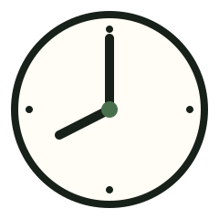

# Tenses

A **tense** shows *when* an action happens. English has twelve: three times (past, present, future) crossed with four aspects (simple, continuous, perfect, perfect continuous).

| Tense | Form | Example |
| --- | --- | --- |
| Present simple | V1 | She walks. |
| Present perfect | has/have + V3 | She has walked. |

> Use **has** with singular subjects and **have** with plural ones.

## All twelve tenses

This table is wider than a phone screen, so it scrolls sideways inside its own box instead of squeezing the columns.

| Time | Aspect | Form | Example | Signal words |
| --- | --- | --- | --- | --- |
| Present | Simple | V1, adds -s for he/she/it | She walks to school. | every day, usually, always |
| Present | Continuous | am/is/are + V-ing | She is walking to school. | now, at the moment, today |
| Present | Perfect | has/have + V3 | She has walked to school. | already, yet, since, for |
| Present | Perfect continuous | has/have been + V-ing | She has been walking for an hour. | for, since, lately, all day |
| Past | Simple | V2 | She walked to school. | yesterday, last week, in 2010 |
| Past | Continuous | was/were + V-ing | She was walking at seven. | while, when, at 7 a.m. |
| Past | Perfect | had + V3 | She had walked home before it rained. | before, by the time, already |
| Past | Perfect continuous | had been + V-ing | She had been walking for an hour. | for, since, before |
| Future | Simple | will + V1 | She will walk to school. | tomorrow, next week, soon |
| Future | Continuous | will be + V-ing | She will be walking at seven. | this time tomorrow, at 7 a.m. |
| Future | Perfect | will have + V3 | She will have walked 5 km by noon. | by noon, by 2030, by the time |
| Future | Perfect continuous | will have been + V-ing | She will have been walking for an hour. | for an hour by then, by next June |

The verbs used in this table

| Base (V1) | Past (V2) | Participle (V3) |
| --- | --- | --- |
| walk | walked | walked |
| go | went | gone |
| write | wrote | written |
| take | took | taken |

**Walk** is regular: it just adds `-ed`. The other three are irregular and have to be
memorised, because V2 and V3 are different forms.

Ready to practice? Take the [tenses quiz](tenses.quiz.md) or go back to [English](index.md).
